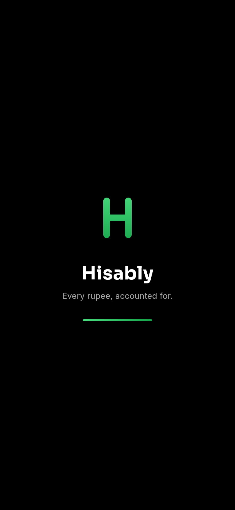
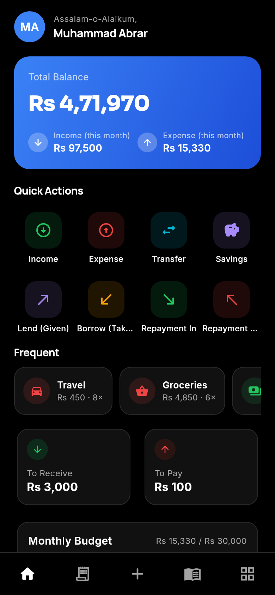
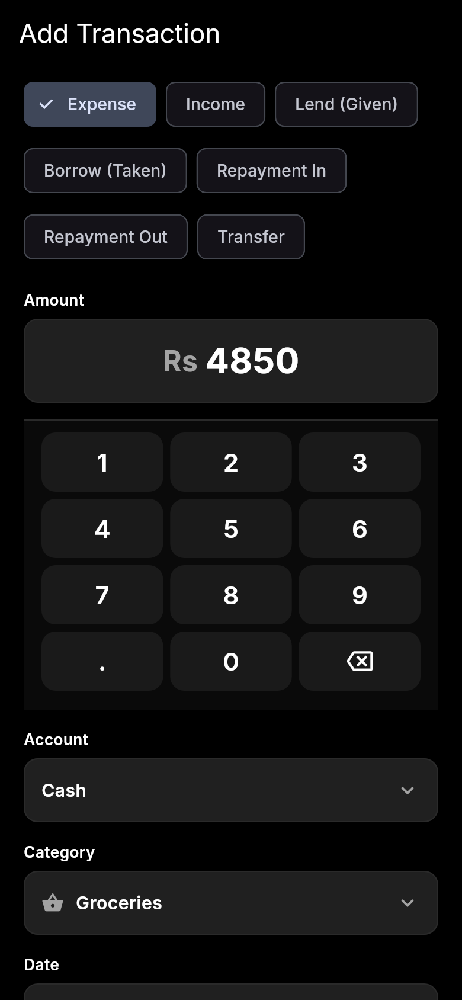
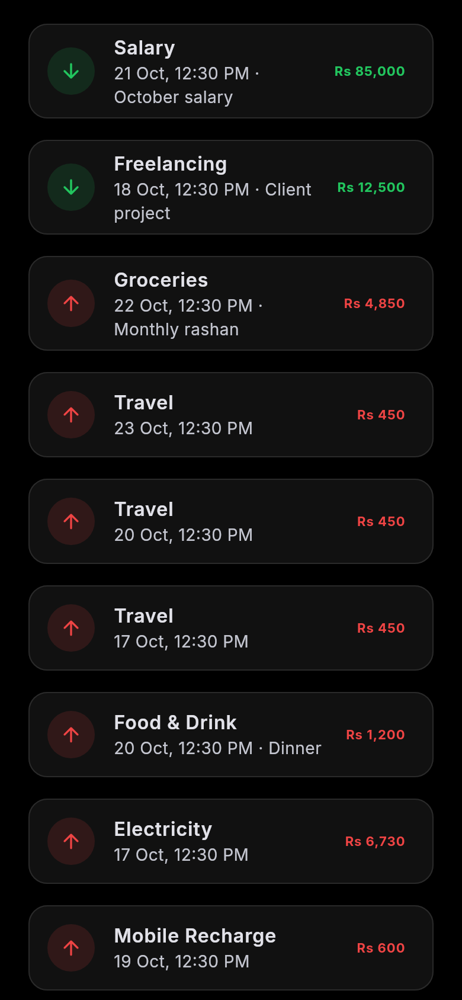
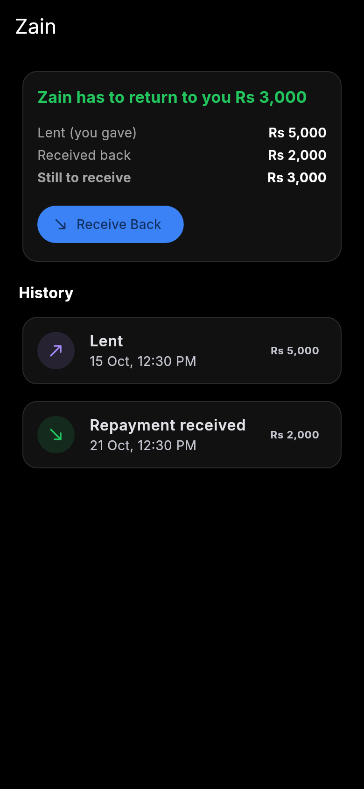
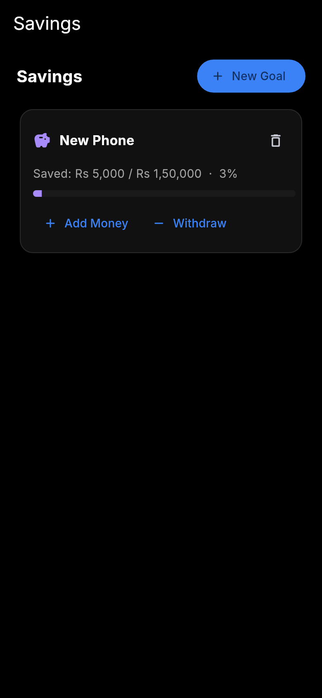
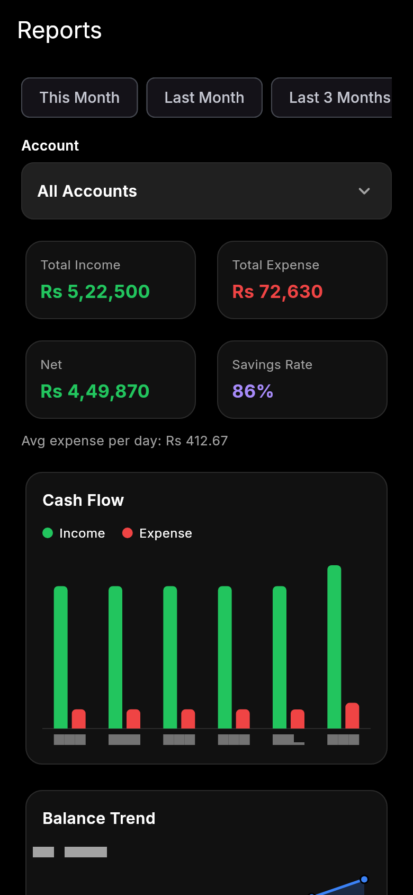

<p align="center">
  
</p>

<h1 align="center">Hisably</h1>

<p align="center"><b>Har rupay ka hisaab.</b> — Every rupee, accounted for.</p>

<p align="center">
  
  
  
</p>

## What is Hisably?

Hisably is a simple money app for Android.

You write down what you earn and what you spend.
The app keeps the record for you — income, expenses, savings,
and money you lend or borrow (your **Khata**).

Everything stays on your phone.
No account. No internet needed. No tracking.

## Status

Hisably is still growing. New things are added from time to time.

This page always has the latest code.

## Get the app

1. Open the **Releases** section of this page.
2. Download **Hisably.apk**.
3. Open the file on your phone and install it.

One APK works on every Android phone (Android 7.0 or newer).

## Screenshots

| Splash | Home |
|---|---|
|  |  |

| Add a transaction | All transactions |
|---|---|
|  |  |

| Khata (money lent and borrowed) | Savings goals |
|---|---|
|  |  |

| Reports |
|---|
|  |

*Pictures are from the real app, with sample data.*

## What you can do

**See your money at a glance**
The home screen shows your total balance, what you earned and spent
this month, and how much money people owe you — or you owe them.

**Add entries in seconds**
Tap a quick action — Income, Expense, Transfer, Lend, Borrow —
and type the amount on the big on-screen keypad.
No keyboard needed. Entries you repeat often come back as one-tap chips.

**Keep a proper Khata**
For every person, Hisably keeps one clear balance.
It tells you in plain words: *"Zain has to return Rs 3,000 to you."*
You can never repay more than what is owed.

**Save for goals**
Make a goal, move money into it, and watch it grow.

**Stay within budget**
Set a monthly budget. Hisably warns you at 70%, 90% and 100%.

**Understand your spending**
Simple reports show where your money went — by month, by category,
and by account.

**Fix mistakes safely**
Wrong entry? Edit it, or reverse it. Nothing is silently deleted —
the history stays honest.

**Lock the app**
Set a 4-digit PIN, and unlock with your fingerprint.

**Keep a backup**
Save all your data in one file, and bring it back any time.

## Your privacy

Your money data never leaves your phone.

Hisably has no server and makes no internet calls.
Your records live only in the app — and in backup files you save yourself.

## For developers

Hisably is built with Flutter and Dart.
All data is stored in a local SQLite database (Drift).
Money is always counted in integer paisa, so totals are never wrong.

```bash
flutter pub get
flutter test
flutter build apk --release
```

Want the full picture? Read the simple guide in
**[docs/ARCHITECTURE.md](docs/ARCHITECTURE.md)**.

Signing keys are not part of this repository.
Add your own `android/key.properties` to make a signed build,
or just run `flutter run` to try the app.

---

Built by **Muhammad Abrar** — *Har rupay ka hisaab.*
